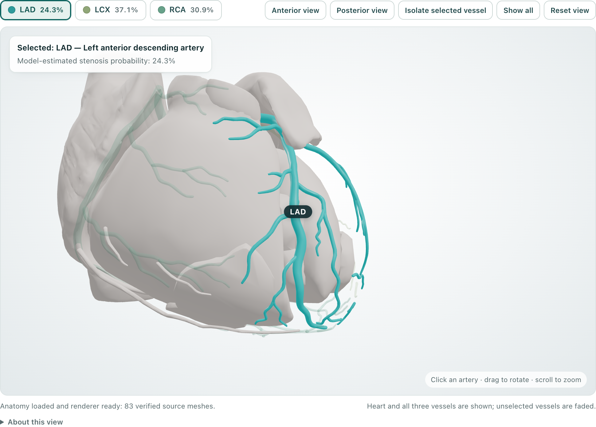
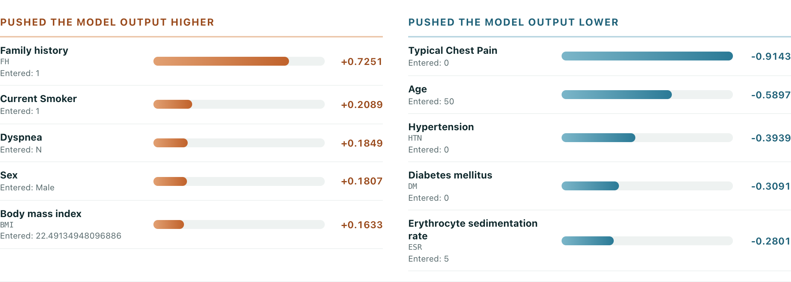
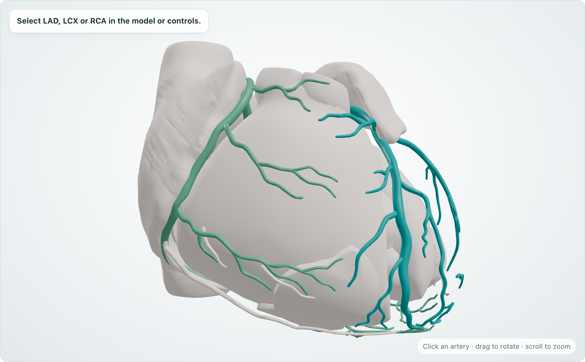
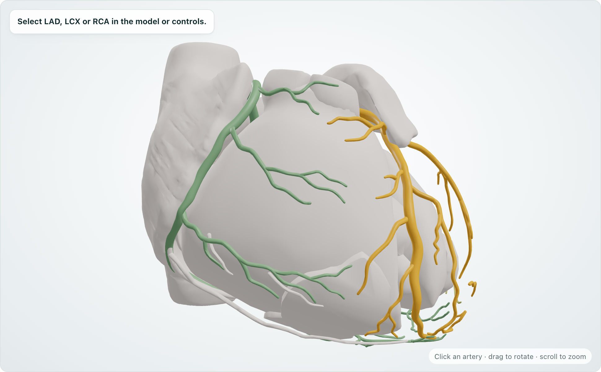
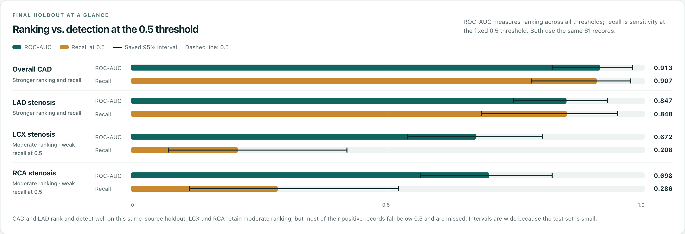

# CardioScope

**Coronary models, made visible.** Click an artery on a real 3D heart to see its frozen-model prediction, the factors that drove it, and the evidence for how far that model can be trusted.



CardioScope is an interactive research prototype for **Track A — Cardiovascular Risk Visualization & Prediction** (Multimodal AI Hackathon 2026). Four frozen classifiers take 55 structured clinical inputs from the public UCI Z-Alizadeh Sani dataset. They estimate **overall coronary artery disease (CAD)** and **stenosis in the LAD, LCX and RCA**. Each output is mapped onto verified BodyParts3D coronary anatomy and explained with SHAP. The models were frozen before a one-time evaluation on a prespecified holdout.

> **Educational and decision-support prototype.** Not a substitute for diagnostic imaging. CardioScope has no external clinical validation, and its probabilities are not calibrated clinical risk.

## Highlights

- **Linked 3D anatomy.** 83 verified BodyParts3D meshes in one coordinate system. Clicking an artery selects its output card and its explanation; selecting a card highlights the artery.
- **Probability on the vessel.** Each whole artery is colored by its own model-estimated probability on one continuous scale, with gold at the 0.5 threshold. The same scale drives the 3D view, the output cards and the legend.
- **Verified explanations.** Signed SHAP contributions with [documented readable names](docs/FEATURE_LABELS.md). Each explanation is accepted only if it adds back up to the model's actual output.
- **Labeled what-if edits.** Change inputs on the public example and rerun the frozen models. The UI labels the result as a hypothetical variation and shows the unedited outputs for comparison.
- **Evidence in the app.** The saved holdout metrics, 95% intervals, confusion matrices and limitations sit next to the predictions.
- **Reproducible.** Locked environments, hash-verified scientific artifacts, Docker, and a CI suite of 134 Python and 75 frontend tests.

## Quick start

Requirements:
- **Python 3.12.14 exactly**: the frozen provenance rejects other patch versions.
- [uv](https://docs.astral.sh/uv/getting-started/installation/) 0.12.1
- [Node.js](https://nodejs.org/) 22.13+ (22.x) or 24+, with npm
- `make`

On macOS:

```sh
git clone https://github.com/AbhikRao/CardioScope.git
cd CardioScope
make install prepare verify build
make run
```

Open <http://127.0.0.1:8000>, click **Load development example**, then **Run prediction**. To use another port, run `make run PORT=8005`.

`make prepare verify` checks the bundled frozen artifacts; it never trains models or touches the holdout. Installation needs network access. After that, the app runs fully locally with no external APIs.

**Linux (Ubuntu).** uv's built-in Linux download is Python 3.12.13, which the frozen app rejects. Build the exact interpreter from the checksum-verified CPython source:

```sh
sudo apt-get install -y build-essential curl xz-utils libssl-dev zlib1g-dev libbz2-dev liblzma-dev libffi-dev libsqlite3-dev libreadline-dev
sh scripts/install_python_linux.sh "$PWD/.runtime/python"
export UV_PYTHON="$PWD/.runtime/python/bin/python3.12"
make install prepare verify build && make run
```

**Docker.** No local Python or Node is needed. The image build also runs the test suite.

```sh
docker build -t cardioscope:v1 .
docker run --rm --read-only --tmpfs /tmp --cap-drop ALL --security-opt no-new-privileges \
  -p 127.0.0.1:8000:8000 cardioscope:v1
```

More detail: [docs/REPRODUCIBILITY.md](docs/REPRODUCIBILITY.md).

## Interactive 3D anatomy

The heart and the LAD, LCX and RCA groups use **83 BodyParts3D mesh leaves** (heart base 30, LAD 18, LCX 6, RCA 29). Each mapping to its anatomical concept is verified, and every mesh keeps its original coordinates. Coronary leaves are removed from the heart base, so nothing is drawn twice.

The viewer supports:
- picking an artery directly on the mesh;
- animated anterior and posterior views;
- orbit, zoom, isolate and show-all.

The selected artery glows in its own probability color and the others fade. Color encodes the **model-estimated probability for the whole vessel**. It does not encode measured narrowing, lesion location or a patient-specific reconstruction. See [interface notes](docs/INTERFACE.md) and [anatomy verification](docs/anatomy/VERIFICATION.md).

## Predictions, explanations and a live what-if

Four separately trained pipelines return a probability and a class at the fixed **0.5** threshold. CAD has its own model; the four outputs are not a joint probability distribution.

**Explanations:**
- CAD/LAD use **Linear SHAP** in positive-class log-odds.
- LCX/RCA use **TreeSHAP** in probability space.
- Both use a fixed 100-record development-only reference.
- Encoded categories are summed back to all 55 source features.
- An explanation is shown only if it reconstructs the model output within a locked tolerance. [Method](docs/EXPLANATIONS.md).



For the public example, *Typical Chest Pain = 0* is the largest factor lowering the CAD output. The example below changes that field and one related field, then reruns the same frozen models:

| Public development example | Hypothetical edit: `Typical Chest Pain` 0→1, `Atypical` Y→N |
|---|---|
|  |  |
| CAD 17.1% · LAD 24.3% · LCX 37.1% · RCA 30.9% (all Normal) | CAD **64.5% (CAD)** · LAD **56.1% (Stenotic)** · LCX 42.1% · RCA 34.8% |

These are model responses to a labeled hypothetical input. They are not a new patient, a treatment effect or a causal claim. LCX and RCA barely respond, which is consistent with their weak holdout sensitivity.

## Evidence

The 303-record dataset was split once into **242 development** and **61 prespecified holdout** records before any model fitting. Configurations were selected with nested cross-validation (5 outer / 3 inner folds) on development data only. All preprocessing was fitted inside the folds, and the target columns `Cath`, `LAD`, `LCX` and `RCA` never enter the inputs. The four pipelines were frozen and then **evaluated once** on the same-source holdout:

| Target | ROC-AUC (95% interval) | Recall at 0.5 | Balanced accuracy | Precision | Brier |
|---|---:|---:|---:|---:|---:|
| CAD | 0.913 (0.819–0.978) | 0.907 | 0.815 | 0.886 | 0.104 |
| LAD | 0.847 (0.745–0.929) | 0.848 | 0.710 | 0.700 | 0.167 |
| LCX | 0.672 (0.537–0.802) | **0.208** | 0.537 | 0.500 | 0.222 |
| RCA | 0.698 (0.563–0.820) | **0.286** | 0.580 | 0.545 | 0.207 |

CAD and LAD rank and detect well. LCX and RCA rank moderately but **miss most positives** at 0.5 (19 of 24 and 15 of 21). This is a small same-source result, not external validation.



Full metrics, confusion matrices and uncertainty methods are in [FINAL_EVALUATION.md](docs/FINAL_EVALUATION.md), and selection is described in [MODELING.md](docs/MODELING.md).

After the holdout, two preregistered **development-only** studies (threshold and model variants, and a four-task neural network) tried to improve LCX/RCA. Both failed their joint gates. Neither is deployed, and V1 remains the product. See the [research overview](research/README.md).

## Architecture


| Layer | Implementation |
|---|---|
| Interface | React 19, TypeScript, Vite; Three.js via React Three Fiber/Drei; lazy-loaded viewer and evidence page |
| API | FastAPI: schema-exact validation, frozen inference, SHAP, saved evidence. Model, schema and profile fingerprints link each prediction to its explanation |
| Models | scikit-learn: balanced L2 logistic regression (CAD, LAD) and shallow random forests (LCX, RCA), stored as checksum-verified joblib pipelines |
| Integrity | 256 protected scientific files with a SHA-256 manifest; a guard allows only one holdout evaluation; no live training |

```text
backend/     FastAPI app, frozen inference, explanations, saved evidence
frontend/    React + TypeScript interface and 3D viewer
ml/          data contract, split, modeling, evaluation and anatomy code
config/      dataset schema, split, search, evaluation and SHAP contracts
artifacts/   frozen V1 models, split, evaluation evidence, SHAP reference; research results
assets/      verified BodyParts3D meshes, mappings and licenses
data/raw/    UCI source archive with provenance
docs/        methodology, evaluation, explanations, reproducibility, report source
research/    post-holdout development-only studies (not used by the app)
tests/       Python test suite (frontend tests live in frontend/src/__tests__)
output/pdf/  six-page Track A report
```

## Testing and reproducibility

```sh
make test     # pytest + vitest
make lint     # ruff + TypeScript
make verify   # 256 protected files, data and anatomy source checks
```

No test touches the real holdout; the evaluation tests use synthetic data and mock artifacts.

GitHub Actions runs the full suite on Ubuntu. The published `main` and `v1.0.0` commits passed it on 4 October 2026: **134 Python and 75 frontend tests**, a smoke test of the frozen models and SHAP, and confirmation that all 256 protected files are byte-identical ([main run](https://github.com/AbhikRao/CardioScope/actions/runs/37225107078), [v1.0.0 run](https://github.com/AbhikRao/CardioScope/actions/runs/37225107079)). Later commits are checked by the same workflow; see the [Actions page](https://github.com/AbhikRao/CardioScope/actions).

## Documentation

- [Six-page Track A report (PDF)](output/pdf/CardioScope-Track-A-Report.pdf), with its [source](docs/report/)
- [Documentation index](docs/README.md): methodology, evaluation, explanations, anatomy, reproducibility and engineering records

## Limitations

- Only 303 records, with a 61-record same-source holdout; there is no external cohort and true patient IDs are unverified.
- Probabilities are uncalibrated, and LCX/RCA sensitivity is weak at the fixed threshold.
- The four outputs are separate classifiers, not a joint model.
- The anatomy is a reference model: no patient-specific geometry, lesion localization or narrowing estimate.
- SHAP describes model behavior, not causality.
- Clinical deployment has not been validated.

## License and attribution

Project code is released under the [MIT License](LICENSE).

- **Dataset:** [UCI Extension of Z-Alizadeh Sani](https://doi.org/10.24432/C5461K), CC BY 4.0.
- **Anatomy:** BodyParts3D, © The Database Center for Life Science, licensed under [CC Attribution 4.0 International](https://dbarchive.biosciencedbc.jp/en/bodyparts3d/lic.html). Source meshes are unchanged; grouping and the shared display transform are documented adaptations.
- **Dependencies:** see [THIRD_PARTY_NOTICES.md](THIRD_PARTY_NOTICES.md) and the [dependency license inventory](docs/licenses/).
