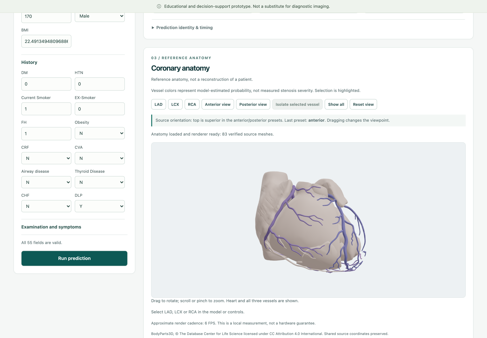
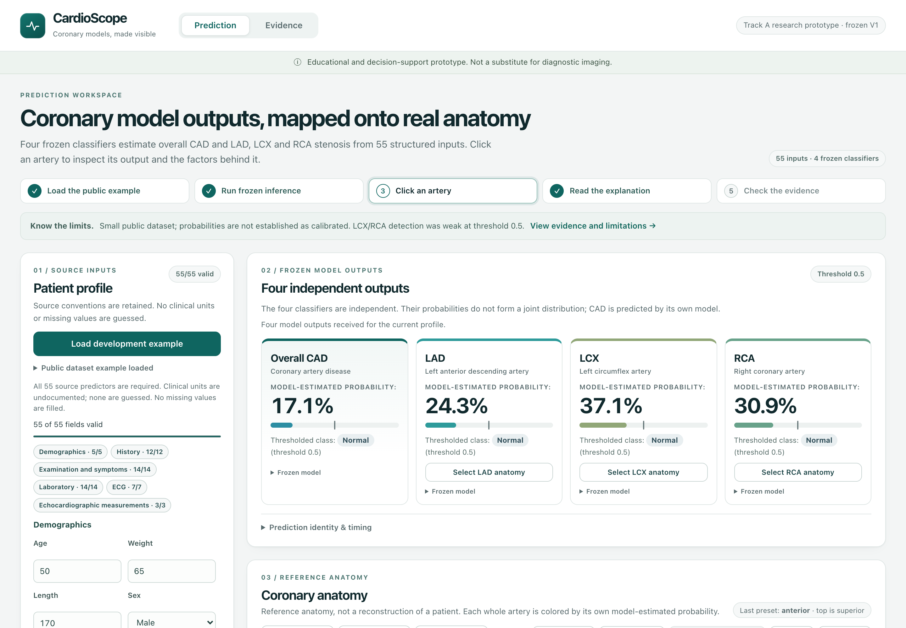
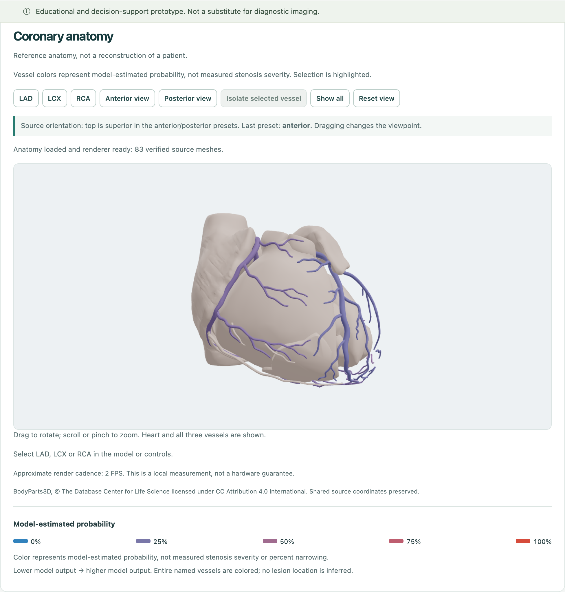
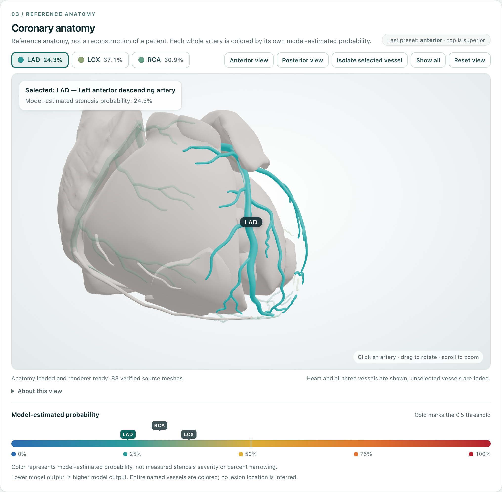
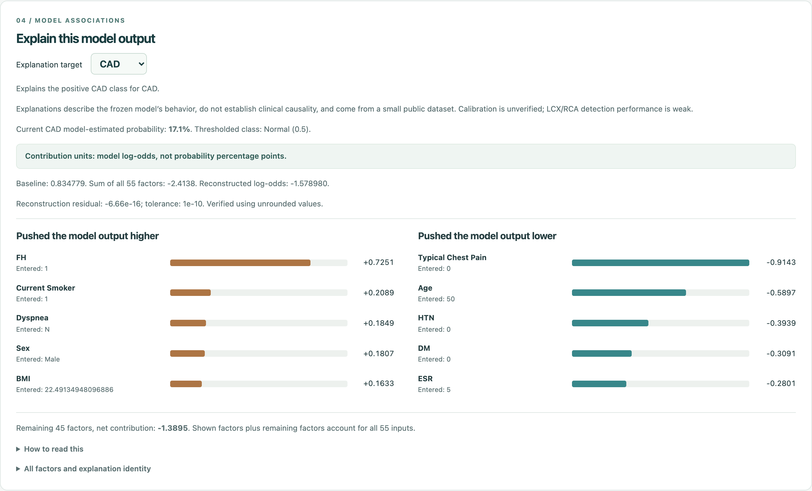
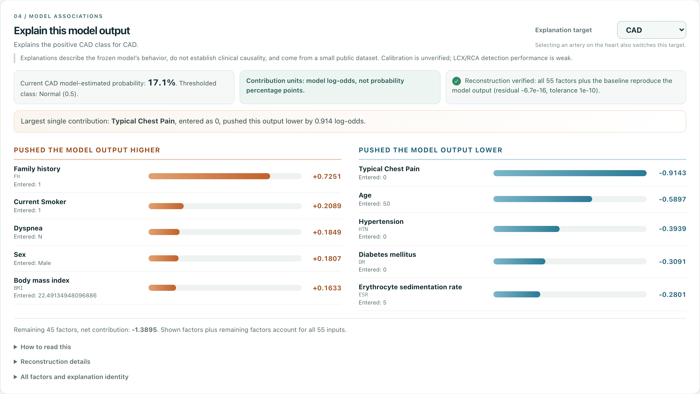

# Design and judge-experience update (12 October 2026)

**Branch:** `design/judge-experience`. This update changes presentation only. It does not change models, thresholds, saved predictions, evaluation results, SHAP mathematics or reference set, anatomical mappings, meshes, the coordinate transform, or the backend. All 256 protected V1 files are byte-identical (see Verification below).

## Why

A read-only audit found four problems:
- The interface hid its strongest qualities. The heart was small, and outputs between 17% and 37% rendered as near-identical lavender.
- Explanations used raw source codes (FH, DLP, ESR) and opened with residual diagnostics.
- The live connection between an input, all four models, the anatomy and the explanation was never visible.
- Several judge-facing documents still claimed that the GitHub push was blocked and hosted CI had never run.

## What changed

**Prediction page**
- A shorter headline and a five-step guide: load the example → run inference → click an artery → read the explanation → check the evidence.
- Four output cards in a single row. Each card has a probability bar, a 0.5 threshold tick, a class pill and the full vessel name.
- The form keeps all 55 fields and their validation in a sticky, scrollable side column. Readable names sit under the codes, outside the `<label>`.

**3D anatomy**
- The stage is larger and the heart fills it. Camera distance adapts to narrow screens.
- Vessel buttons carry color swatches and probabilities. A selection readout and a usage hint sit over the canvas, and secondary notes moved into *About this view*.
- When a vessel is selected, it glows in its *own* probability color and the other vessels fade. Highlighting therefore never changes a vessel's hue.
- Preset changes animate the camera around the superior axis. This is skipped under `prefers-reduced-motion` and stops as soon as the user drags.

**Color scale**
- `probabilityColor` now interpolates five fixed stops in OKLab: blue `#2c6db2` (0), teal `#2e9c9a` (0.25), gold `#dcae37` (0.5 threshold), orange `#df7430` (0.75) and red `#b3202e` (1). The scale is continuous, and probability maps to a fixed ordered hue path.
- The v1 blend kept lightness constant: the OKLab distance per 0.05 step was 0.013–0.017. The new scale measures 0.027–0.048 at aligned steps, and a test enforces more than 0.02 everywhere.
- The legend gradient is sampled from the same function, so the legend cannot drift from the geometry. Legend markers show where LAD, LCX and RCA sit on the scale.
- The `hardening.test.tsx` test that pinned the v1 blend was replaced by property tests: exact stops, continuity, perceptual spacing and invalid-input rejection.

**Hypothetical edits**
- After the public example is loaded, any edited field is outlined. An amber note lists the changes (`Typical Chest Pain 0 → 1`, …) and says the result is not a real patient, a clinical intervention or a validated causal effect.
- A **Restore the unedited example** button reloads the original values.
- Results for an edited profile are labeled as a hypothetical variation. Each card shows the unedited example's frozen output for comparison, using the same model version.
- No new example was added. The example selection rule (smallest development record ID, chosen without looking at outcomes) is unchanged.

**Explanation panel**
- Header with a target picker; the panel notes that clicking an artery also switches the target.
- Three summary chips: probability and class, contribution units, and a ✓ *Reconstruction verified* badge showing the residual and tolerance.
- A plain-language sentence names the largest single contribution.
- Signed factor columns show readable names, the source code and the entered value.
- Baseline and residual lines moved into a *Reconstruction details* section. The table of all 55 factors gains a readable-name column. All numbers are unchanged.

**Readable names**
- [docs/FEATURE_LABELS.md](../FEATURE_LABELS.md) lists 33 documented expansions with sources.
- `Atypical`, `Length` and `CR` stay unexpanded, and no units were added.

**Evidence page**
- A new *Ranking vs. detection* chart shows ROC-AUC and recall at 0.5 for each target, with the saved 95% interval whiskers and a 0.5 reference line.
- Each card states its strength honestly: *Stronger ranking and recall* or *Moderate ranking · weak recall at 0.5*.
- True-positive and false-negative matrix cells are tinted.
- A new, visually distinct *Post-holdout studies did not change the product* section links the V2 and V2.1 reports. Every existing metric, interval, limitation and source remains.

**Documents**
- README, Devpost copy, judge Q&A and the submission checklist now state that hosted CI passed.
- Dated status notes were appended to CLAIM_AUDIT, PUBLICATION, HARDENING and PLAN; the historical text was not rewritten.
- The six-page report was rebuilt: pages 1, 4, 5 and 6 changed; pages 2–3 are unchanged.
- The demo script and rehearsal were rewritten.

## Verified hypothetical sequence

This sequence uses frozen V1 inference in the running production build and is repeated in [DEMO_REHEARSAL.md](DEMO_REHEARSAL.md). It starts from the public development example `0056fb5a…733dc`:

1. Load the example and run prediction: CAD 17.1%, LAD 24.3%, LCX 37.1%, RCA 30.9%, all Normal.
2. Click the LAD mesh: the card, readout and explanation target switch to LAD.
3. Click **Select LCX anatomy**: the camera animates to posterior and the explanation switches to LCX.
4. Set **Typical Chest Pain** 0 → 1 and **Atypical** Y → N (valid source values only), then run prediction.
5. Result: **CAD 64.5% (CAD)**, **LAD 56.1% (Stenotic)**, LCX 42.1%, RCA 34.8% (Normal); deltas +47.4 / +31.7 / +5.0 / +3.9 points. LAD turns gold on the heart. In the CAD explanation, Typical Chest Pain goes from −0.9143 to +0.9143 log-odds.

The CAD/LAD movement shows how the frozen models behave on one hypothetical variation with two changed inputs. It is not clinical effectiveness and not a causal claim.

## Before / after (real captures)

| | Before (v1 UI) | After |
|---|---|---|
| Overview |  |  |
| Anatomy |  |  |
| Explanation |  |  |

More captures:
- [hypothetical outputs and anatomy](assets/v2/outputs-anatomy-hypothetical.png)
- [hypothetical edit note](assets/v2/hypothetical-edit-form.png)
- [evidence chart](assets/v2/evidence-glance.png)
- [mobile anatomy](assets/v2/mobile-anatomy.png)

Hashes, viewport, device scale, the browser and the visible outputs for every image are in [assets/v2/provenance.json](assets/v2/provenance.json). The "after" images come from the production build (`frontend/dist` served by `backend.app`) in Playwright Chromium 151 with headless SwiftShader WebGL. The baseline images were captured before any change, from the same frozen models on the Vite dev server. No image was edited or composited.

## Verification

Results are recorded in [DESIGN_VERIFICATION.json](DESIGN_VERIFICATION.json).

**Commands**
- `npm test`: 75/75 frontend tests passed.
- `make lint`: ruff and TypeScript passed.
- `make verify`: 256 protected files byte-identical, plus the data and anatomy source checks.
- `make build`: production build passed; initial JS is 259,557 bytes.
- Documented safe Python subset: 43 tests passed.
- Documentation link check passed.

**Report**
- Rebuilt in the separate document environment from [REPORT_BUILD.md](REPORT_BUILD.md).
- Exactly 6 pages, all reviewed visually.
- The build checks every v2 screenshot hash and that the page-4 numbers match the captured UI outputs.

**Browser**
- Checked in the in-app Chromium pane at 1440 × 1000: real mesh picking (LAD), card → mesh (LCX), isolate, show all, reset, the explanation following selection, the hypothetical edit and the Evidence page.
- No console errors.
- Mobile layout checked at 390 × 844.

**Not done**
- Model training, holdout inference, and the fitting/evaluation test modules (the full 134-test suite). Hosted CI ran those for the published V1 commits; this branch is unpushed, so its hosted run is pending.
